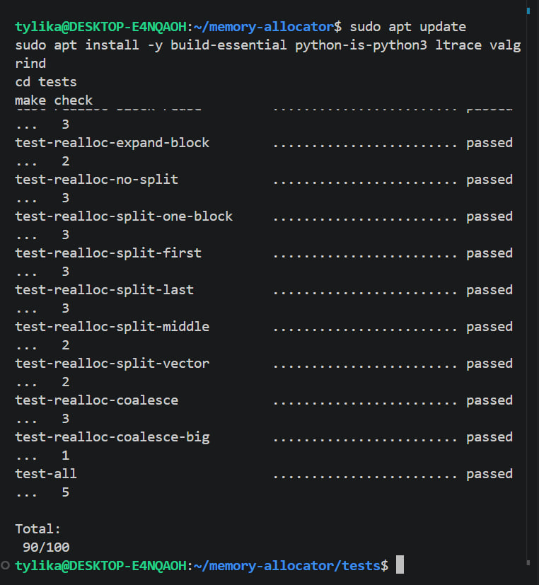
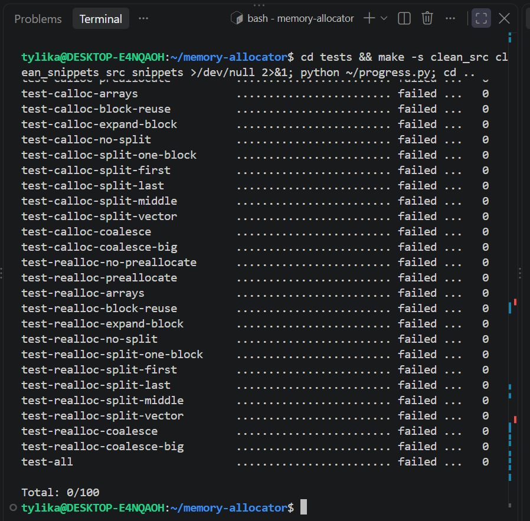
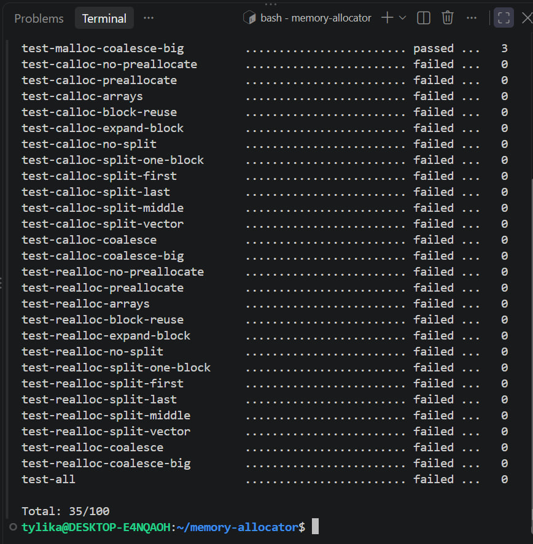
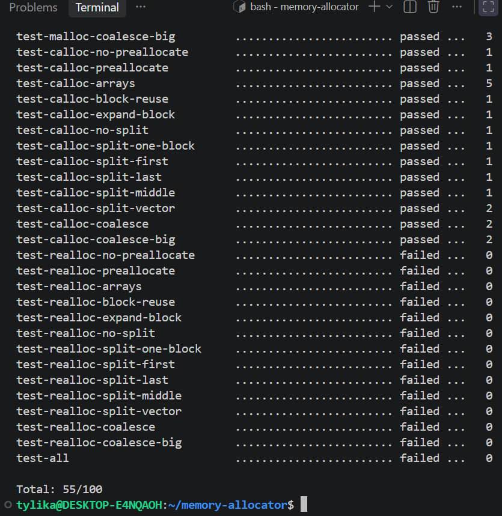
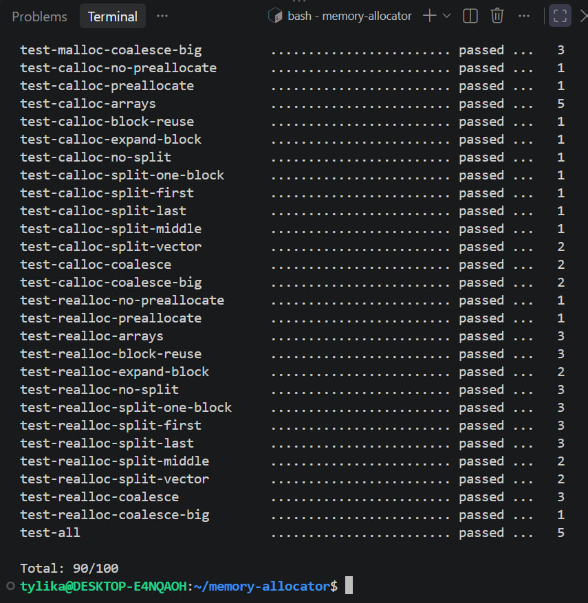

# Memory Allocator

A minimalistic memory allocator written in C. It implements `os_malloc()`, `os_calloc()`, `os_realloc()` and `os_free()` on top of the Linux memory management syscalls `brk()`, `mmap()` and `munmap()`.

This is a solution to the [Memory Allocator assignment](https://github.com/open-education-hub/operating-systems/tree/main/content/assignments/memory-allocator) from the Open Education Hub *Operating Systems* course. The full statement is kept in [ASSIGNMENT.md](ASSIGNMENT.md).

## Test results

All 40 tests pass, including the `valgrind` memory leak checks (`make check`). The total is **90/100**, which is the maximum the automated tests award: the points of all 40 tests in `run_tests.py` add up to 90.



### Progress by stage

The allocator was built in stages. After each stage the tests were run again:

| Stage | Commit | Tests passed | Score |
|-------|--------|--------------|-------|
| 1 | Assignment skeleton | 0 / 40 | 0/100 |
| 2 | Block management helpers | 0 / 40 | 0/100 |
| 3 | `os_malloc` and `os_free` | 13 / 40 | 35/100 |
| 4 | `os_calloc` | 26 / 40 | 55/100 |
| 5 | `os_realloc` | 40 / 40 | 90/100 |

<details>
<summary>Stage 1: skeleton, all tests fail</summary>



</details>

<details>
<summary>Stage 3: malloc and free, all malloc tests pass</summary>



</details>

<details>
<summary>Stage 4: calloc, all malloc and calloc tests pass</summary>



</details>

<details>
<summary>Stage 5: realloc, all tests pass</summary>



</details>

## Project structure

```text
.
├── src/
│   ├── osmem.c      # public API: os_malloc, os_calloc, os_realloc, os_free
│   ├── helpers.c    # block management: heap list, brk/mmap, split, coalesce, find best
│   ├── helpers.h    # constants, alignment macros and helper prototypes
│   └── Makefile     # builds libosmem.so
├── tests/           # test snippets, reference outputs and the checker (run_tests.py)
├── utils/           # library interface, struct block_meta, heap-free printf
├── screenshots/     # screenshots of the test runs (per stage and final)
└── ASSIGNMENT.md    # original assignment statement
```

## Implementation

### Blocks

Every allocated zone starts with a `struct block_meta` header (32 bytes) followed by the payload. The pointer returned to the user is the address of the payload. All sizes are rounded up to a multiple of **8 bytes**, so both the header and the payload are always 8-byte aligned.

A block can be in one of three states:

| Status          | Meaning                                       |
|-----------------|-----------------------------------------------|
| `STATUS_ALLOC`  | heap block in use                             |
| `STATUS_FREE`   | heap block available for reuse                |
| `STATUS_MAPPED` | block obtained with `mmap()`                  |

Heap blocks are kept in a doubly linked list ordered by address. They are contiguous in memory: each block starts right after the previous one. Mapped blocks are independent and are not kept in the list.

### Heap or `mmap()`

| Function    | Uses `mmap()` when header + aligned size is at least | Otherwise |
|-------------|------------------------------------------------------|-----------|
| `os_malloc` | `MMAP_THRESHOLD` (128 KiB)                            | heap      |
| `os_calloc` | page size (`getpagesize()`, 4 KiB)                    | heap      |

`os_free()` releases mapped blocks with `munmap()`. Heap blocks are only marked as free and are kept for future allocations; the heap is never shrunk.

### Heap allocation

1. **Preallocation.** The first time the heap is used, a single 128 KiB chunk is requested with `brk()`. It becomes one large free block that later allocations split. This happens only once.
2. **Coalescing.** Before searching, every run of adjacent free blocks is merged into one block. This reduces external fragmentation.
3. **Find best.** The whole list is scanned and the smallest free block that fits the request is chosen.
4. **Splitting.** If the chosen block is bigger than needed and the remainder can hold a header plus at least 8 bytes, the remainder becomes a new free block. This reduces internal fragmentation.
5. **Growing the heap.** If no free block fits and the last block on the heap is free, only that block is expanded with `brk()` by the missing amount. Otherwise a new block is added at the end of the heap.

### `os_realloc()`

- `os_realloc(NULL, size)` behaves like `os_malloc(size)`, and `os_realloc(ptr, 0)` behaves like `os_free(ptr)`.
- Reallocating a block that is already free returns `NULL`.
- A heap block that stays below the mmap threshold is resized **in place** when possible:
  - when shrinking, the block is split and the rest becomes free;
  - when growing, the following free blocks are absorbed one at a time, checking after each merge whether the block is big enough (merged blocks stay merged even if it is still too small);
  - if the block is the last one on the heap, it is expanded with `brk()`.
- In every other case (mapped blocks, blocks that cross the mmap threshold, or no room to expand) a new block is allocated, the data is copied and the old block is freed.

Every syscall result is checked with the `DIE()` macro. `mremap()` is not used.

## Building and testing

The tests need Linux (`brk()`), together with `gcc`, `make`, `python3`, `ltrace` and `valgrind`. On Ubuntu:

```console
sudo apt install build-essential python-is-python3 ltrace valgrind
```

Build the library:

```console
cd src/
make
```

Build the library and the tests, then run the whole test suite with memory leak checks:

```console
cd tests/
make check
```

Run a single test, showing the diff against the reference output:

```console
cd tests/
python run_tests.py -d test-all
```

> **Note:** `make check-fast` from the original `tests/Makefile` calls `run-tests.py`, while the script is named `run_tests.py`. Use `python run_tests.py -d` to run the tests without the leak checks.

## Code style

The sources follow the Linux kernel coding style used by the course and pass `checkpatch.pl` with no errors and no warnings.

## AI assistance

This project was developed with the help of Claude, an AI assistant by Anthropic. It was used to study the assignment requirements and tests, to write and debug the allocator code, and to prepare this README.
